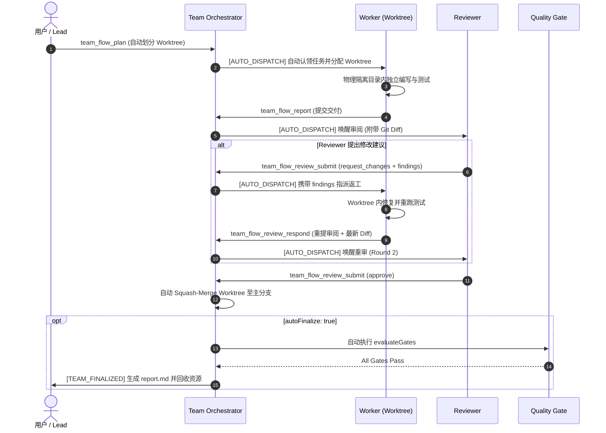

# 36 · 全自动闭环收敛与返工自驱动体系（v1.21.0）

> 目标：打通 DSH Agent Team 自主协作的最后闭环 ——
> 1. 返工自驱动：Reviewer 提出修改意见时，精准下达 findings 并引导 Worker 修复与回应；
> 2. 差异自递送：重构后的代码再次自动提取最新差异并送审；
> 3. 审查者验证权限：允许分配的 Reviewer 在 Worktree 隔离目录下直接运行 `verify` 检验真实测试；
> 4. 全自主闭环终审（Auto-Finalize）：全项批准且门禁通过后，Orchestrator 自动执行最终报告写入、共享任务关闭、临时 Worktree 清理，彻底消除人工停摆。

---

## 1. 核心机制演进

### 1.1 返工闭环自驱动（Self-Healing Rework Loop）
- **触发条件**：Reviewer 调用 `team_flow_review_submit` 并给出 `request_changes`（携带结构化 findings，包含 severity / file / line / claim）。
- **优化前**：Orchestrator 仅发送普通的“任务就绪”通知，且错误地指示 Worker 调用 `team_flow_report`，导致 Worker 产生动作冲突与重读黑板消耗。
- **优化后**：
  - Orchestrator 自动解析最新一轮的 findings，提取出条理清晰的缺陷列表；
  - 发送精准的 `[AUTO_DISPATCH]` 返工指令：
    ```text
    [AUTO_DISPATCH] Task W1 "Fix parser" requires rework based on reviewer findings (Round 1).
    Reviewer findings:
      1. [F1] (major): src/parser.js:42 Unhandled edge case in parsing
    Please address these findings inside your worktree, run tests, and call team_flow_review_respond with one response per finding id (fixed | rebut | accepted_risk) and updated evidence.
    ```
  - Worker 明确知晓需在专属 Worktree 内修正并调用 `team_flow_review_respond`。

### 1.2 审查者独立复测权限（Reviewer Independent Verification）
- **优化前**：`team_flow_git { action: 'verify' }` 严格校验 `requireOwner(item)`，导致 Reviewer 想要在作者的 Worktree 中重跑测试时被权限拦截。
- **优化后**：放宽验证权限，除 Owner 和 Lead 外，**当前工作项已分配的 Reviewer（`item.reviewers`）亦可直接调用 `team_flow_git { action: 'verify', item_id }`**。
- **效果**：Reviewer 无需盲信报告，可在受限隔离环境中直接复现测试命令并检验真实 Exit Code。

### 1.3 终审自主收敛（Autonomous Convergence / Auto-Finalize）
- **配置项**：`settings.autoFinalize`（布尔值，在 Profile 121 中默认激活 `true`）。
- **驱动逻辑**：
  - 当所有工作项均达到 `approved` 状态时，Orchestrator 自动调用 `evaluateGates` 对全队执行门禁检验（报告完整度、退出码、写范围、未决阻断）；
  - **若 Gate 顺利通过**：
    1. 自动推进 Phase 为 `finalized` 并记录终审时间戳；
    2. 自动生成并写入 Markdown 交付报告至 `.agentteam/teams/<teamId>/report.md`；
    3. 自动将关联的所有原生 Task 状态标记为 `completed`，不留半开状态；
    4. 自动调用 `autoCleanupRunWorktrees` 销毁回收临时分支与目录；
    5. 向 Lead 及全局广播 `[TEAM_FINALIZED]` 完工通知及报告文件路径；
  - **若 Gate 存在未决阻断（如需 Lead 特批 Override）**：保持严谨门禁底线，不强行通过，发送通知引导 Lead 人工仲裁。

---

## 2. 状态机全生命周期（从需求到交付零干预）



---

## 3. 验证套件执行记录

- `@local/dsh-tool-guard-kit`: 9/9 pass
- `@local/dsh-agent-team-workflow`: 235/235 pass
  - `test/orchestrator.test.mjs`: 6/6 pass（含返工定向唤醒、全自动终审测试）
  - `test/tools.integration.test.mjs`: 37/37 pass（含 Reviewer 独立运行 verify 测试）
  - 全套件 14 个测试文件共 244 项自动化测试全部通过，0 失败。
