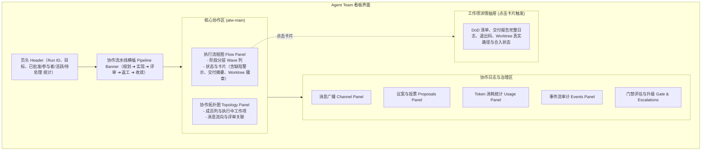

# 37 · 全局看板与成员协作状态全景透视（v1.22.0）

> 目标：解决 Agent Team 看板“无法直观洞察团队宏观推进阶段、具体执行内容、返工原因与 Worktree 物理隔离进展”的问题。
> 1. **顶层宏观协作流水线横幅（Pipeline Flow Banner）**：一目了然透视全队处于 `规划拆解 ➔ 并行实现 ➔ 交叉评审 ➔ 缺陷返工 ➔ 终审收敛` 哪一阶段，并附带动态分步项计数与状态提醒；
> 2. **工作项卡片直观内容预览（Card Live Previews）**：
>    - 缺陷实时预警：处于 `changes_requested` 或有未解决缺陷时，卡片顶部显眼展示 `[待修复缺陷] 文件:行号 · 缺陷批注`，一眼洞悉打回原因；
>    - 交付摘要预览：完成交付后，卡片展示交付摘要文字（Summary Preview），无需点击即可直接检视产出成果；
> 3. **物理隔离 Worktree 全生命周期徽章**：实时标识工作项的专属 Worktree 分支与合并状态（`⎇ 隔离开发中` vs `✓ 已合入`）；
> 4. **详情抽屉与拓扑图增强**：抽屉完整展示 Worktree 绝对路径与分支，拓扑图与状态区无缝协同，严格保持零外部依赖与主题 Token 安全契约。

---

## 1. 架构演进与设计规范

### 1.1 数据层聚合 (`lib/dashboard.js`)
- **`run.pipelineStage`**：
  纯函数计算当前团队的宏观协作阶段（`planning` | `implementing` | `reviewing` | `reworking` | `converged` | `finalized`）。
  - 所有项均已批准且已归档 ➔ `finalized`；
  - 所有项已批准或 Gate 已就绪 ➔ `converged`；
  - 存在打回修改项（`changes_requested`）➔ `reworking`；
  - 存在待审阅项（`in_review`）➔ `reviewing`；
  - 存在运行中或已提交 Commit 校验项 ➔ `implementing`；
  - 初始或无活动项 ➔ `planning`。
- **`item.summaryPreview`**：直接截取 `raw.report?.summary` 前 140 字符，流式直出。
- **`item.latestFinding`**：解析倒序 review 记录，提取最新一条未决缺陷的 `{ id, severity, file, line, claim }`。
- **`item.git` 增强**：增加 `worktreePath`（物理路径）与 `worktreeMerged`（布尔值，指示是否已自动合入主分支）。
- **契约不变性保证**：`run.counts` 严格保持 `{ total, approved, pending, inReview, changesRequested, escalated }` 6 项经典键名，确保下游兼容。

---

### 1.2 表现层增强 (`client.js`)
- **宏观协作流水线横幅 (`renderPipelineBanner`)**：
  - 包含 5 个核心步骤节点：
    1. 规划拆解（Planning）
    2. 并行实现（Implementing，附带进行中任务数）
    3. 交叉评审（Reviewing，附带待审项数）
    4. 缺陷返工（Reworking，附带待修项数）
    5. 终审收敛（Converged，附带已批准数）
  - 根据活跃阶段动态切换 `active`、`done`、`upcoming` 高亮样式；
  - 在缺陷返工期展示警告横条（`发现缺陷，成员正在针对性修改中`），终审时展示收敛提示。
- **工作项卡片增强 (`renderItemCard`)**：
  - **缺陷警示条 (`atw-card-finding`)**：若卡片处于待修改状态，以明显警示风格展示缺陷位置与诉求；
  - **交付成果条 (`atw-card-summary`)**：若已有交付报告，卡片内展示带气泡图标的交付摘要；
  - **Git 徽章区 (`atw-badge--git`)**：自动渲染 Worktree 隔离分支与已合入标记（`✓ 已合入` / `⎇ 物理隔离`）；
  - **契约合规**：卡片底部的 `atw-card-flags`（轮次与依赖关系）严格保持为卡片的最末子元素，且总数保持在 4 个以内，符合前端契约测试。
- **主题 Token 与零外部依赖契约**：
  - 严格只使用 `--dsw-alias-*` 主题变量与 `color-mix(in oklab, ...)`；
  - 绝不硬编码十六进制色值（`#...`）或 `rgba(...)`；
  - 中英双语（`zh` / `en`）字典严格 100% 镜像对称。

---

## 2. 看板视图结构总览

---

## 3. 验证套件覆盖

| 验证项 | 验证入口 | 结果 |
| :--- | :--- | :--- |
| **快照聚合测试** | `node --test test/dashboard*.test.mjs` | **41/41 通过**（含 pipelineStage, latestFinding, summaryPreview, worktree） |
| **前端契约测试** | `node --test test/client.contract.test.mjs` | **41/41 通过**（双语字典对称、无硬编码色值、卡片徽章预算） |
| **全量回归测试** | `node --test packages/tool-guard-kit/test/kit.test.mjs && node --test packages/agent-team-workflow/test/*.test.mjs` | **246/246 全绿**（0 失败，0 告警） |
