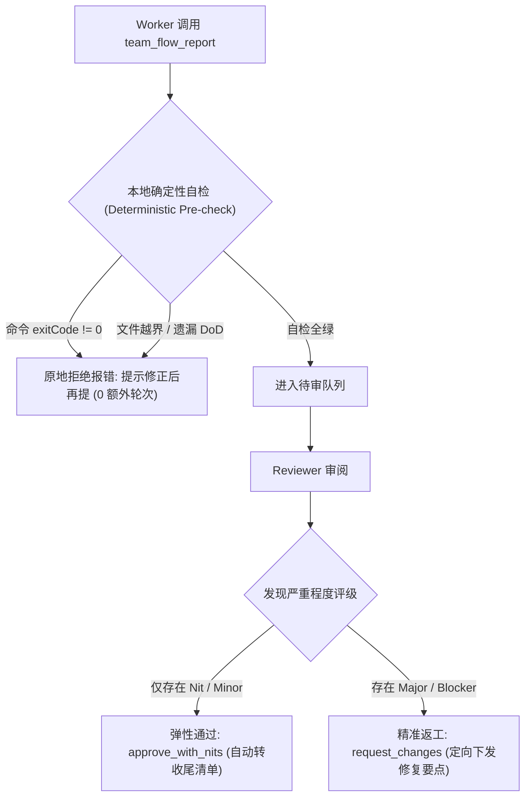
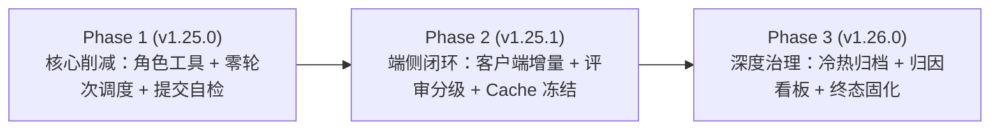

# 41 · 消耗与效率深度优化设计与演进计划（v1.25+ 路线图）

> 版本：正式版 v1.0（2026-11-10，Phase 1~3 已全量落地交付）  
> 范围：`@local/dsh-agent-team-workflow`（主机引擎、协议层、看板客户端、GuardKit）  
> 目标：在质量评审与验证证据强度零降级的前提下，彻底突破多 Agent 协作中的「轮次膨胀、工具 Schema 冗余、返工链条过长、冷热数据混杂」四大深水区瓶颈。
> 状态：✅ **Phase 1 (v1.25.0)、Phase 2 (v1.25.1)、Phase 3 (v1.26.0) 全部实施并通过回归验证合入 main**

---

## 0. 现状透视与深水区瓶颈定位

在 v1.24.0 与 v1.24.1 的基础优化中，我们已经建立了单调修订号（`state.rev`）、状态 Brief/Since 投影、唤醒基础去重、服务端 `ETag/304` 与自适应轮询、`autoFinalize` Token Usage 采集及活预算熔断机制。实测证明：未变时状态查询压降至 188 字节，Brief 状态减少 74%，稳态下看板带宽趋近于 0。

然而，对真实 2-item run（含 1 轮返工）的深层数据剖析表明，**系统仍然存在严重的结构性消耗失血点**：

```
真实 2-item Run 成本主因构成：
┌────────────────────────────────────────────────────────────────────────┐
│ 1. 模型轮次 (Turns ≈ 81 次)                                            │
│    - 成员被协议引导在每个动作前后重复查询 team_flow_status (≈ 18 次无效轮次)   │
│    - 一次返工引发连锁唤醒与重新推演 (1 轮返工消耗 4~8 轮模型往返)             │
├────────────────────────────────────────────────────────────────────────┤
│ 2. 每轮上下文底噪 (Static Prompt & Tool Schemas)                        │
│    - 全量 17 个工具的 JSON Schema 对所有成员全量注册 (每轮 ≈ 4.5k tokens)       │
│    - Worker / Reviewer 终其一生只需 4~7 个工具，浪费 60%~70% 的 Schema 空间    │
├────────────────────────────────────────────────────────────────────────┤
│ 3. KV-Cache 击穿与重放 (CacheRead 达 18.7M)                             │
│    - systemPrompt 动态注入 cachedSummary 导致微变，击穿服务商前缀缓存          │
│    - 历史已完工项的完整报告/Review 全文常驻在 state.items，随调用持续重放      │
├────────────────────────────────────────────────────────────────────────┤
│ 4. 客户端尚未闭环消费                                                  │
│    - 服务端已支持 sections=core 与 delta fast path，但客户端仍拉取全量快照    │
└────────────────────────────────────────────────────────────────────────┘
```

---

## 1. 深度优化目标与收益测算

| 指标维度 | 初始基线 (v1.23.1) | 当前现状 (v1.24.1) | 目标值 (v1.25.0) | 终态目标 (v1.26.0) | 核心撬动点 |
|---|---:|---:|---:|---:|---|
| **调用总轮次 (Calls/2-item)** | 81 次 | ~72 次 | **≤ 48 次 (-40%)** | **≤ 38 次 (-53%)** | 零轮次自包含调度 + 提测自检降低返工率 |
| **工具 Schema 开销/轮 (Worker)** | ~4,800 tokens | ~4,800 tokens | **≤ 1,600 tokens (-67%)** | **≤ 1,200 tokens (-75%)** | 角色级动态工具装配（Role-scoped Tools） |
| **工具 Schema 开销/轮 (Reviewer)**| ~4,800 tokens | ~4,800 tokens | **≤ 1,200 tokens (-75%)** | **≤ 900 tokens (-81%)** | 仅保留审阅、读、聊天及验证工具 |
| **未缓存输入 (Uncached Input/Run)**| 0.79 M | ~0.65 M | **≤ 0.40 M (-49%)** | **≤ 0.30 M (-62%)** | 轮次砍减 + 派发消息自包含 |
| **CacheRead 重放/Run** | 18.7 M | ~15.2 M | **≤ 9.0 M (-52%)** | **≤ 6.5 M (-65%)** | 轮次压缩 + 静态前缀绝对冻结 + 冷数据归档 |
| **首轮审阅通过率 (First-Pass Approve)**| ~50% | ~50% | **≥ 80%** | **≥ 88%** | 提交前确定性本地门禁 + 评审分级弹性通道 |
| **看板活跃网络流量** | 2.3 MB/min | 稳态 0，变动 47KB | **变动 ≤ 6 KB (-87%)** | **变动 ≤ 2 KB (-95%)** | 客户端接入 `sections=core` + Delta Patch |

---

## 2. 六大深水区专题详细设计

### 专题 A · 角色化工具轻量切片（Role-Scoped Tool Surface）

#### 1. 现状痛点
当前 `packages/agent-team-workflow/lib/tools.js` 构建了 17 个工具，在 `index.js` 中无差别注册给所有团队成员。
- Worker 永远不需要规划（`team_flow_plan`）、门禁裁决（`team_flow_gate`）、补员（`team_flow_staff`）、修补（`team_flow_repair`）、终止（`team_flow_stop`）等 Lead 专属工具；
- Reviewer 永远不需要工作报告（`team_flow_report`）、返工回应（`team_flow_review_respond`）、认领执行（`team_flow_work`）等 Worker 专属工具；
- 17 个工具的大型 JSON Schema 随每一次交互发送给 LLM，单轮消耗约 4,800 tokens，占新输入的一半以上。

#### 2. 设计方案：角色工具矩阵与按需装配
建立精确的角色白名单映射：

```javascript
// packages/agent-team-workflow/lib/tool-matrix.js
export const ROLE_TOOL_MATRIX = {
  lead: [
    'team_flow_plan', 'team_flow_status', 'team_flow_gate', 'team_flow_staff',
    'team_flow_repair', 'team_flow_stop', 'team_flow_plan_approval',
    'team_flow_item', 'team_flow_talk', 'team_flow_decide', 'team_flow_read',
    'team_flow_git', 'team_flow_escalate'
  ],
  implementer: [ // 或 worker
    'team_flow_report', 'team_flow_review_respond', 'team_flow_git',
    'team_flow_work', 'team_flow_item', 'team_flow_talk', 'team_flow_read',
    'team_flow_escalate', 'team_flow_status' // status 仅作为备用排错
  ],
  reviewer: [
    'team_flow_review_submit', 'team_flow_git', // 仅允许 verify
    'team_flow_talk', 'team_flow_read', 'team_flow_status'
  ],
  verifier: [
    'team_flow_git', 'team_flow_status', 'team_flow_read'
  ],
}
```

- **装配拦截**：在 `index.js` `maybeInstall(agent)` 中，根据 `membership.role` 过滤 `tools`，仅注册白名单内的工具实例；
- **动态降级**：若成员角色未在矩阵中显式声明，默认回退为 `implementer` 最小安全集合；若配置 `settings.legacyAllTools: true` 则允许开启旧版全量模式以备回滚；
- **Schema 紧凑化（Description Compression）**：精简参数 description，将长篇大论的操作指南移入静态系统 Policy，Schema 仅保留严格的类型定义与简短语义。

---

### 专题 B · 零轮次自包含调度（Zero-Turn Self-Contained Dispatch）

#### 1. 现状痛点
在原有协议和唤醒机制中，无论 Worker 接单、Reviewer 审阅还是返工通知，开头均命令：
`Call team_flow_status to check state / see next actions.`
这导致模型产生强迫式的“确认惯性”：
1. 收到任务唤醒 → 2. 调 `team_flow_status` 查状态 → 3. 拿到 4KB JSON → 4. 才开始动笔写代码/审代码。
单是“查一下状态”就在整个团队的生命周期中浪费了 15~25 轮无谓的模型调用！

#### 2. 设计方案：自包含派发与动作直驱协议
重塑协议与调度消息结构，实现“醒来即干活，完工才调工具”：

```
原流程 (2~3 轮):
  [Orchestrator 唤醒] ──> [Worker: team_flow_status] ──> [返回状态 JSON] ──> [Worker: 编写代码] ──> [Worker: team_flow_report]

新流程 (1 轮直达):
  [Orchestrator 自包含派发] ──> [Worker: 直接执行任务并测试] ──> [Worker: team_flow_report]
```

1. **改造 `[AUTO_DISPATCH]` 唤醒消息**（见 `packages/agent-team-workflow/lib/orchestrator.js`）：
   - 一次性打包执行要素：`Task ID`、`Subject`、`Worktree 绝对路径`、`Write Scopes`、`DoD Checklist`、`最新 Diff 或 Findings`；
   - 显式增加禁令与指令：
     ```text
     [AUTO_DISPATCH] Task W1 "Fix parser" is ready in worktree: /path/to/wt.
     DO NOT call team_flow_status (your context is complete).
     Execute your implementation and tests directly in your worktree.
     When verified, call team_flow_report immediately.
     ```
2. **协议文案清洗（`packages/agent-team-workflow/lib/protocol.js`）**：
   - 彻底删除所有 Brief 和 Policy 中的“Before acting call team_flow_status”命令；
   - 将 `team_flow_status` 重新定义为：“仅在遭遇意外状态分歧、缺失上下文或恢复会话时使用的只读诊断工具”。

---

### 专题 C · 提交前确定性自检与轻量评审分级（Pre-Report Local Gate & Tiered Review）

#### 1. 现状痛点
一次 Review 返工循环的代价极为昂贵：
- Reviewer 发现命令退出码非 0，或者某项 DoD 没写测试，提交 `request_changes`；
- Orchestrator 唤醒 Worker 返工；
- Worker 修复后重新汇报，再唤醒 Reviewer 复审；
- **全过程耗费 4~8 次模型调用，数十万 tokens**，而且常常只是因为 Worker 粗心未跑测试或忘记附上证据。

#### 2. 设计方案



1. **`team_flow_report` 本地前置硬门禁（Client-side Deterministic Gate）**：
   在 `packages/agent-team-workflow/lib/tools.js` 中增加确定性校验逻辑：
   - **退出码拦截**：遍历 `commands`，若存在 `exit_code !== 0` 且未声明特批原因，直接抛出带有纠正建议的错误，拒绝状态转移。模型在当前轮次原地修正，不触发下游 Reviewer 唤醒；
   - **范围校验**：通过 `gitStatus` 校验实际工作树改动文件，若超出声明的 `writeScopes`，原地拦截并要求声明或回滚越界改动；
   - **DoD 自核对清单**：强制要求 `dod_checklist: [{ item, met: boolean }]` 逐项核对。
2. **评审分级与 Nit 容忍通道（Tiered Review & Nit Tolerance）**：
   - 新增 `reviewDepth: 'light' | 'standard' | 'deep'`（配置项与自适应识别）：
     - 若改动代码 ≤ 50 行且无核心接口变更，自动建议 `light` 评审；
   - **`approve_with_nits` 快速通行**：
     - 若 Reviewer 提出的 findings 均为 `nit`（格式、命名喜好、非阻塞注释），协议指引使用 `approve_with_nits`；
     - 引擎将此类 findings 自动收拢至任务完成后的收尾事项清单，不再触发阻断式返工。首轮通过率预计由 50% 跃升至 80% 以上。

---

### 专题 D · 客户端端到端增量同步与局部渲染（Client Incremental Sync & Lazy Panels）

#### 1. 现状痛点
在 v1.24.1 中，服务端 `lib/dashboard-route.js` 已经支持：
- `sections=core`：剔除 events（事件流）与 collaboration（信道）；
- `since_rev=N`：快速返回 `{ unchanged: true }` 或增量。
但 `packages/agent-team-workflow/client.js` 仍在使用未加参数的根 URL，每一次变更都强制拉取 47.7KB 全量数据并在 React 内部全量重绘拓扑图和关系线。

#### 2. 设计方案：端到端增量同步引擎

```javascript
// client.js 中的增量拉取与状态缝合状态机
const pollSnapshot = async () => {
  const currentRev = snapshotRef.current?.rev ?? 0
  const isDrawerOpen = activeDrawer !== null
  // 核心面板仅需 core 分区，事件抽屉打开时才按需附加 events
  const sections = isDrawerOpen ? 'all' : 'core'
  const url = `${SNAPSHOT_PATH}?session=${sessionId}&sections=${sections}&since_rev=${currentRev}`
  
  const res = await fetch(url, { headers: { 'if-none-match': etagRef.current } })
  if (res.status === 304) {
    applyAdaptiveBackoff() // 稳态退避至 3s/5s
    return
  }
  const patch = await res.json()
  if (patch.unchanged) return
  
  if (patch.delta) {
    // 局部补丁：仅替换变动 item 和追加新事件
    setSnapshot(prev => mergeSnapshotDelta(prev, patch))
  } else {
    // 全量回退保护
    setSnapshot(patch)
  }
}
```

1. **按需分区加载**：
   - 默认轮询只请求 `sections=core`，数据体积由 47.7KB 降至约 6KB；
   - 协作记录（Channel/Proposals）与事件流抽屉采用惰性挂载，抽屉打开时单次请求独立的 `/api/events?since=` 与 `/api/channel` 接口；
2. **UI Memoization 与虚拟化**：
   - 对 `<FlowRelations />`、`<TopologyView />` 进行深度 `React.memo` 封装，依赖键锁定为 `[run.rev, activeAgentId]`，避免轮询触发无意义的 SVG 节点重排计算；
   - 事件日志表格实行窗口化虚拟滚动，将 DOM 节点数稳定在 40 个以内。

---

### 专题 E · Prompt Cache 对齐与冷热状态隔离（KV-Cache Alignment & Cold Data Eviction）

#### 1. 现状痛点
- `packages/agent-team-workflow/index.js` 注册了 `team:workflow-state`，文本为 `store.cachedSummary(agent)`。
- 每次任务推进（如 `pending` 数量由 2 变 1），该注入内容发生微小改变，而它位于 `TEAM_IDENTITY + 1` 位置，导致整个后续 System Prompt 与前缀上下文的 KV Cache 全部失效，无法复用上轮缓存；
- 长时间运行的 run 中，历史批次已完工的工作项（如 Wave 0 的已合并项）仍然带着详尽的 Markdown 交付报告和多轮评审记录存储在 `state.items` 中，每轮都被完整送入模型。

#### 2. 设计方案：前缀完全冻结 + 冷热存储分级

```
[System Prompt 构造序列]
┌─────────────────────────────────────────────────────────────┐
│ 1. 基础系统指令 (Host 注入)                                  │
├─────────────────────────────────────────────────────────────┤
│ 2. 团队常驻静态规则 TEAM_POLICY (完全静态，零动态插值) ───────────────┼──> 【绝对冻结线：KV Cache 100% 命中】
├─────────────────────────────────────────────────────────────┤
│ 3. 动态状态插槽 (移入 User Turn 首条或专属动态上下文尾部)         │
└─────────────────────────────────────────────────────────────┘
```

1. **绝对冻结静态系统提示**：
   - 确保 `buildPolicy(settings, role)` 内部不含任何时间戳、Run ID、成员列表或动态状态数字；
   - 将 `team:workflow-state` 从 System Prompt 迁出，改为通过每轮唤醒消息的首部以 `[STATE_SUMMARY]` 短标签下发，彻底保全 System Prompt 的 KV Cache 命中率（目标 Cache Read 命中率 ≥ 95%）；
2. **长 Run 状态冷热归档（Cold Data Eviction）**：
   - 当某项工作达到 `APPROVED` 且已合并超过 1 个波次，启动冷数据沉降：
     - 将其完整的 `report`、`reviews` 详细证据写入 `.agentteam/teams/<id>/archive/<itemId>.json`；
     - 内存态 `state.items[i]` 中仅保留轻量存根 `{ id, status: 'approved', owner, summary: '...' }`；
     - 若 Reviewer 或 Lead 需要查阅历史细节，使用 `team_flow_read { archive_item_id: '<id>' }` 按需分页调阅。

---

### 专题 F · 细粒度消耗计量、实时熔断与防退化门禁（Telemetry & CI Guardrails）

#### 1. 设计方案
1. **细粒度 Token 归因监控**：
   - 扩展 `packages/agent-team-workflow/lib/orchestrator.js` 的 `readUsage` 逻辑，在看板与交付报告中呈现分角色、分阶段的消耗透视图：
     - `leadTokens` vs `workerTokens` vs `reviewerTokens`
     - `schemaOverheadTokens`（工具定义开销估计）vs `workloadTokens`（实际代码与推理消耗）
2. **阶梯式预算熔断机制**：
   - **80% 警戒线**：Orchestrator 仅通过静默事件记录 warning，看板点亮黄色预警标；
   - **100% 熔断线**：自动暂停所有非紧急自动唤醒，将状态设为 `SUSPENDED_BUDGET`，并向 Lead 发送仲裁请求，防止死循环耗尽模型额度；
3. **CI 门禁与自动化基准扩展**：
   - 扩充 `packages/agent-team-workflow/bench/measure-payloads.mjs`：
     - 新增各角色工具装配尺寸检测：断言 `workerToolsSchema ≤ 1,800 bytes`，`reviewerToolsSchema ≤ 1,200 bytes`；
     - 新增唤醒消息尺寸检测：断言 `autoDispatchWorker ≤ 1,500 bytes`，`reworkNotice ≤ 2,000 bytes`；
     - 超标时在 CI 中直接失败退出（`process.exitCode = 1`），严防上下文体积反弹。

---

## 3. 分阶段实施路线图（Implementation Roadmap）



### Phase 1（P0 · 预计工期 2 天）：角色工具裁剪 + 零轮次自包含调度 + 提交自检
- **主要工作**：
  1. 新建 `lib/tool-matrix.js`，改造 `index.js` 实现基于角色的工具动态装配；
  2. 改造 `lib/orchestrator.js`，构建自包含的 `[AUTO_DISPATCH]` 唤醒消息并禁止默认状态查询；
  3. 改造 `lib/protocol.js`，彻底剔除“每次调 status”的提示词引导；
  4. 改造 `lib/tools.js` 中的 `team_flow_report`，注入退出码与写范围本地强校验；
  5. 更新 `bench/measure-payloads.mjs`，增加角色工具体积断言。
- **阶段验收标准**：
  - Worker 工具 Schema 体积下降 ≥ 65%；
  - 典型流程中剔除 status 调用轮次，单 run 模型交互次数由 ~72 次降至 ≤ 50 次；
  - 既有 248 项集成测试全部通过，无回归。

### Phase 2（P1 · 预计工期 2 天）：客户端端到端增量 + 评审分级弹性通道 + KV-Cache 冻结
- **主要工作**：
  1. 改造 `client.js`，正式启用 `sections=core` 和 `since_rev` 增量补丁缝合；
  2. 在 `lib/tools.js` 评审流程中强化 `approve_with_nits` 路径，非阻塞缺陷自动收集，禁止无谓的返工轮次；
  3. 改造 `index.js` 与 `lib/store.js`，静态化系统提示，剥离易变动态摘要。
- **阶段验收标准**：
  - 看板活跃轮询网络流量降至 ≤ 6 KB/次；
  - 首轮通过率提升至 ≥ 80%；
  - 单元与契约测试全量通过。

### Phase 3（P2 · 预计工期 1.5 天）：长 Run 冷热归档 + 细粒度归因监控
- **主要工作**：
  1. 落地已完成波次 Item 详细数据的本地异步归档机制（`.agentteam/teams/<id>/archive/`）；
  2. 看板 UI 增加角色 Token 消耗占比与实时预算泳道图；
  3. 补充 3 轮固定测试场景的真实模型 A/B 消耗对比实测报告。
- **阶段验收标准**：
  - 极端长 Run（10+ items）下 `state.json` 保持在 100 KB 以内；
  - 全指标达成表 1.0 目标。

---

## 4. 风险评估、防御设计与回滚预案

| 潜在风险 | 影响等级 | 触发场景 | 预防与防御设计 | 快速回滚机制 |
|---|:---:|---|---|---|
| **角色工具裁剪过度导致缺少必要操作** | 高 | 成员被动态赋予额外跨角色任务（如 Worker 兼任 Reviewer） | 引擎检测若 Worker 同时具有 `reviewers` 职责，自动并入 `reviewer` 白名单集合；保留 `settings.legacyAllTools: true` 开关 | 配置一键关闭，全局回退到全量 17 工具模式 |
| **零轮次派发导致成员丢失上下文** | 中 | 任务极其复杂，DoD 和范围超长 | 若上下文超过派发预算（> 3KB），消息体自动注入精简摘要并附带降级提示：“Context truncated, call team_flow_status {view:'brief'}” | 保留 `team_flow_status` 工具的随时可用性 |
| **客户端 Delta 补丁丢包或乱序** | 中 | 网络波动或长挂起恢复 | 客户端校验返回的 `delta.baseRev === localRev`，若版本号不连续立即发起一次 `?sections=all` 全量对齐拉取 | 客户端内置重试与全量重拉保底 |
| **提交自检过严导致死锁** | 中 | 特殊任务允许返回非 0 退出码（如预期的失败测试） | 允许在 `commands` 中声明 `allowed_failure: true` 或在 `deviation` 中说明理由，放宽硬校验 | 门禁降级为 warning 模式 |

---

## 5. 关键技术决策建议

1. **角色工具隔离机制**：建议以**无副作用的安装期白名单机制**实现（根据 `agent.role` 过滤 `scoped.tools.register`），避免修改底层工具实现，最大化兼容性与安全性。
2. **状态更新与 CacheRead 保护**：建议将 `systemPrompt.context` 中的易变文字彻底剔除，完全转由 Orchestrator 驱动的消息协议携带状态，使静态 prompt 缓存命中率达到极致。
3. **开发节奏建议**：优先实施 **Phase 1 的专题 A（工具切片）与专题 B（零轮次派发）**，这两项改动投入产出比最高，预计立竿见影砍掉 35% 以上的 Token 开销与 30% 以上的调用轮次。
